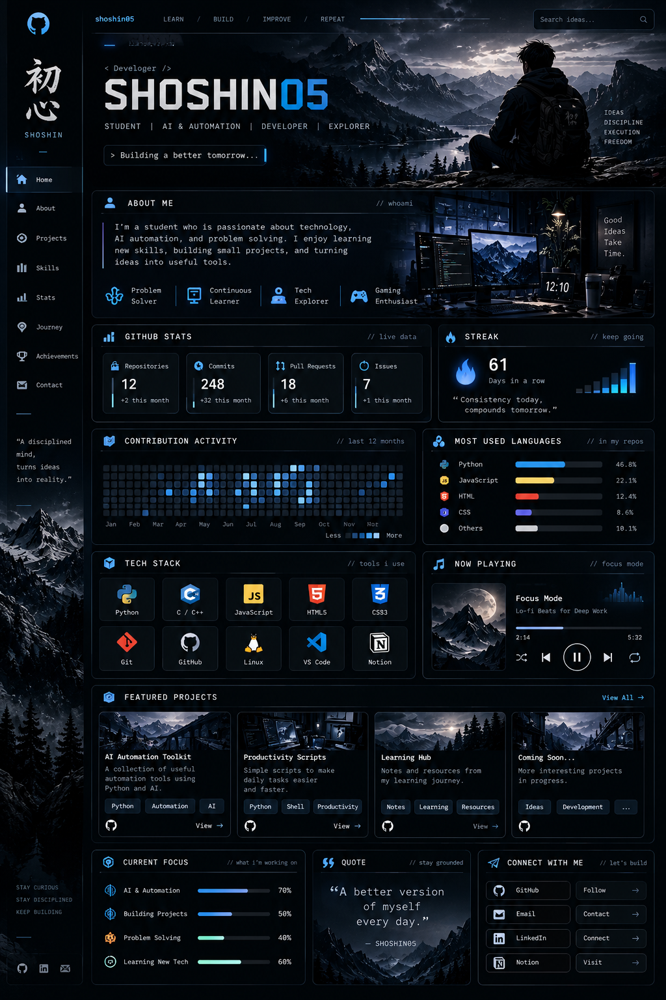

<!-- The dashboard above is the exact concept image. Its depicted numbers, buttons, and music player are illustrative, not live. -->

### Live GitHub activity

---

### About me

AI & ML student exploring intelligent systems, automation and software development. Learning, building and improving one project at a time.

### Projects

Explore my [repositories](https://github.com/shoshin05?tab=repositories).

---

Design: black / graphite / electric blue · Learn / Build / Improve / Repeat
