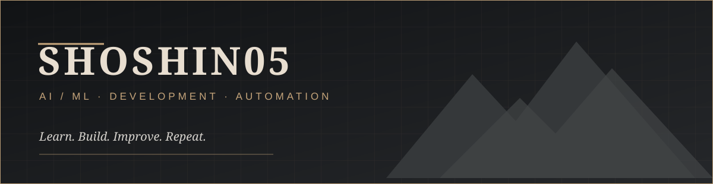

### Building with purpose. Learning with consistency.

**B.Tech AI & ML Student** · **Developer in Progress** · **Automation Enthusiast**

---

### About me

I'm an AI & Machine Learning student interested in turning ideas into practical software. I'm developing my skills in programming, intelligent systems, and automation through consistent learning and hands-on projects.

- **Currently exploring:** AI, machine learning, and workflow automation
- **What drives me:** Useful technology, problem-solving, and thoughtful design
- **Beyond code:** Gaming and discovering new technology
- **Approach:** Learn → Build → Improve → Repeat

### Tools & technologies

  

*Growing this stack as I learn.*

### GitHub activity

### What I'm working toward

| Focus | Direction |
| :-- | :-- |
| AI & ML | Understand concepts and build real applications |
| Automation | Create tools that simplify repetitive work |
| Software development | Write maintainable, useful code |
| Open source | Learn from and contribute to other projects |

### Selected projects

> **Under construction.** I'll feature projects here as I publish them.

---

*“Quiet progress. Strong foundations. Work that speaks for itself.”*

Thanks for visiting · <a href="https://github.com/shoshin05?tab=repositories">Explore my repositories</a>

